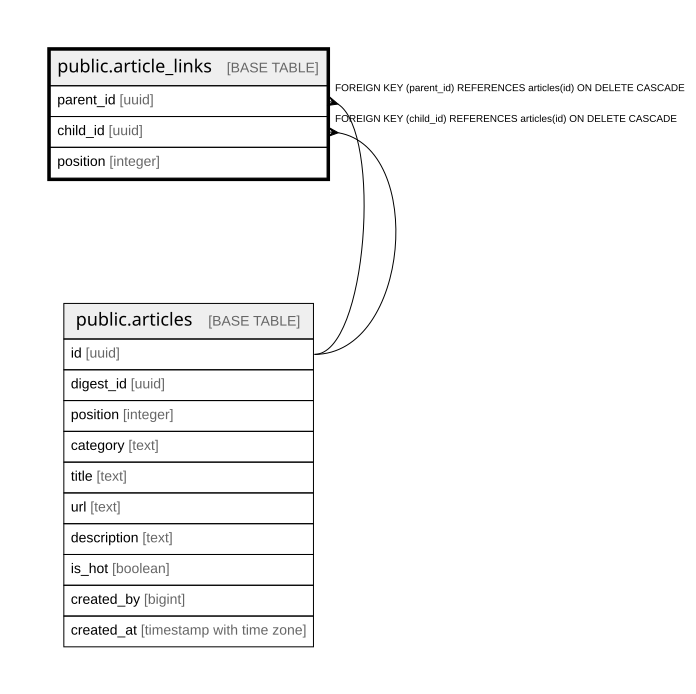

# public.article_links

## Columns

| Name | Type | Default | Nullable | Children | Parents | Comment |
| ---- | ---- | ------- | -------- | -------- | ------- | ------- |
| parent_id | uuid |  | false |  | [public.articles](public.articles.md) |  |
| child_id | uuid |  | false |  | [public.articles](public.articles.md) |  |
| position | integer |  | false |  |  |  |

## Constraints

| Name | Type | Definition |
| ---- | ---- | ---------- |
| article_links_check | CHECK | CHECK ((parent_id <> child_id)) |
| article_links_child_id_not_null | n | NOT NULL child_id |
| article_links_parent_id_not_null | n | NOT NULL parent_id |
| article_links_position_not_null | n | NOT NULL "position" |
| article_links_child_id_fkey | FOREIGN KEY | FOREIGN KEY (child_id) REFERENCES articles(id) ON DELETE CASCADE |
| article_links_parent_id_fkey | FOREIGN KEY | FOREIGN KEY (parent_id) REFERENCES articles(id) ON DELETE CASCADE |
| article_links_pkey | PRIMARY KEY | PRIMARY KEY (child_id) |
| article_links_parent_id_position_key | UNIQUE | UNIQUE (parent_id, "position") |

## Indexes

| Name | Definition |
| ---- | ---------- |
| article_links_pkey | CREATE UNIQUE INDEX article_links_pkey ON public.article_links USING btree (child_id) |
| article_links_parent_id_position_key | CREATE UNIQUE INDEX article_links_parent_id_position_key ON public.article_links USING btree (parent_id, "position") |

## Relations

---

> Generated by [tbls](https://github.com/k1LoW/tbls)
