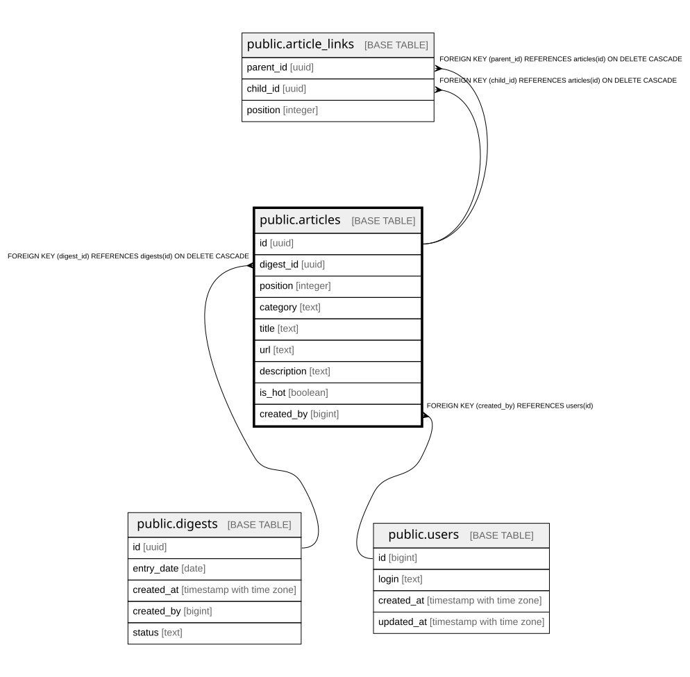

# public.articles

## Columns

| Name | Type | Default | Nullable | Children | Parents | Comment |
| ---- | ---- | ------- | -------- | -------- | ------- | ------- |
| id | uuid | gen_random_uuid() | false | [public.article_links](public.article_links.md) |  |  |
| digest_id | uuid |  | false |  | [public.digests](public.digests.md) |  |
| position | integer |  | false |  |  |  |
| category | text |  | false |  |  |  |
| title | text |  | false |  |  |  |
| url | text |  | false |  |  |  |
| description | text |  | true |  |  |  |
| is_hot | boolean | false | false |  |  |  |
| created_by | bigint |  | false |  | [public.users](public.users.md) |  |
| created_at | timestamp with time zone | now() | false |  |  |  |

## Constraints

| Name | Type | Definition |
| ---- | ---- | ---------- |
| articles_category_check | CHECK | CHECK ((category = ANY (ARRAY['セキュリティ'::text, 'IT系'::text, 'UI系'::text, 'AI系'::text, '面白そうなツール・サービス'::text, 'その他'::text]))) |
| articles_category_not_null | n | NOT NULL category |
| articles_created_at_not_null | n | NOT NULL created_at |
| articles_created_by_not_null | n | NOT NULL created_by |
| articles_digest_id_not_null | n | NOT NULL digest_id |
| articles_id_not_null | n | NOT NULL id |
| articles_is_hot_not_null | n | NOT NULL is_hot |
| articles_position_not_null | n | NOT NULL "position" |
| articles_title_check | CHECK | CHECK ((title <> ''::text)) |
| articles_title_not_null | n | NOT NULL title |
| articles_url_check | CHECK | CHECK ((url <> ''::text)) |
| articles_url_not_null | n | NOT NULL url |
| articles_url_scheme_check | CHECK | CHECK ((url ~ '^https?://'::text)) |
| articles_digest_id_fkey | FOREIGN KEY | FOREIGN KEY (digest_id) REFERENCES digests(id) ON DELETE CASCADE |
| articles_pkey | PRIMARY KEY | PRIMARY KEY (id) |
| articles_created_by_fkey | FOREIGN KEY | FOREIGN KEY (created_by) REFERENCES users(id) |
| articles_created_by_url_key | UNIQUE | UNIQUE (created_by, url) |
| articles_digest_id_position_key | UNIQUE | UNIQUE (digest_id, "position") DEFERRABLE INITIALLY DEFERRED |

## Indexes

| Name | Definition |
| ---- | ---------- |
| articles_pkey | CREATE UNIQUE INDEX articles_pkey ON public.articles USING btree (id) |
| articles_created_by_url_key | CREATE UNIQUE INDEX articles_created_by_url_key ON public.articles USING btree (created_by, url) |
| articles_digest_id_position_key | CREATE UNIQUE INDEX articles_digest_id_position_key ON public.articles USING btree (digest_id, "position") |

## Relations

---

> Generated by [tbls](https://github.com/k1LoW/tbls)
