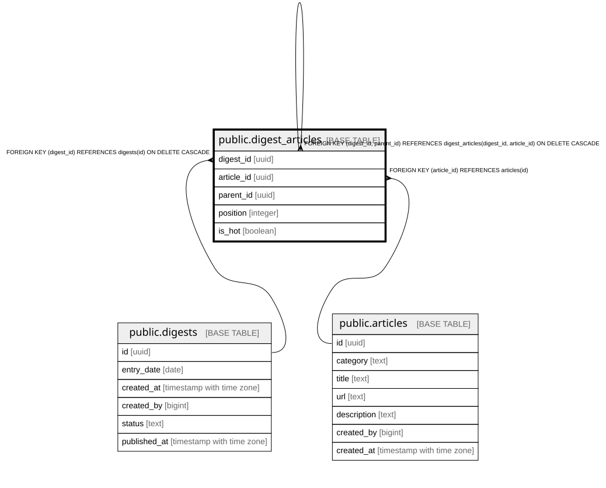

# public.digest_articles

## Columns

| Name | Type | Default | Nullable | Children | Parents | Comment |
| ---- | ---- | ------- | -------- | -------- | ------- | ------- |
| digest_id | uuid |  | false | [public.digest_articles](public.digest_articles.md) | [public.digests](public.digests.md) [public.digest_articles](public.digest_articles.md) |  |
| article_id | uuid |  | false | [public.digest_articles](public.digest_articles.md) | [public.articles](public.articles.md) |  |
| parent_id | uuid |  | true |  | [public.digest_articles](public.digest_articles.md) |  |
| position | integer |  | false |  |  |  |
| is_hot | boolean | false | false |  |  |  |
| is_repost | boolean | false | false |  |  |  |

## Constraints

| Name | Type | Definition |
| ---- | ---- | ---------- |
| digest_articles_article_id_not_null | n | NOT NULL article_id |
| digest_articles_check | CHECK | CHECK ((parent_id <> article_id)) |
| digest_articles_check1 | CHECK | CHECK (((NOT is_repost) OR ((parent_id IS NULL) AND (NOT is_hot)))) |
| digest_articles_digest_id_not_null | n | NOT NULL digest_id |
| digest_articles_is_hot_not_null | n | NOT NULL is_hot |
| digest_articles_is_repost_not_null | n | NOT NULL is_repost |
| digest_articles_position_not_null | n | NOT NULL "position" |
| digest_articles_digest_id_fkey | FOREIGN KEY | FOREIGN KEY (digest_id) REFERENCES digests(id) ON DELETE CASCADE |
| digest_articles_article_id_fkey | FOREIGN KEY | FOREIGN KEY (article_id) REFERENCES articles(id) |
| digest_articles_digest_id_parent_id_fkey | FOREIGN KEY | FOREIGN KEY (digest_id, parent_id) REFERENCES digest_articles(digest_id, article_id) ON DELETE CASCADE |
| digest_articles_pkey | PRIMARY KEY | PRIMARY KEY (digest_id, article_id) |
| digest_articles_digest_id_position_key | UNIQUE | UNIQUE (digest_id, "position") |

## Indexes

| Name | Definition |
| ---- | ---------- |
| digest_articles_pkey | CREATE UNIQUE INDEX digest_articles_pkey ON public.digest_articles USING btree (digest_id, article_id) |
| digest_articles_digest_id_position_key | CREATE UNIQUE INDEX digest_articles_digest_id_position_key ON public.digest_articles USING btree (digest_id, "position") |
| digest_articles_original_key | CREATE UNIQUE INDEX digest_articles_original_key ON public.digest_articles USING btree (article_id) WHERE (NOT is_repost) |
| digest_articles_article_id_idx | CREATE INDEX digest_articles_article_id_idx ON public.digest_articles USING btree (article_id) |

## Relations

---

> Generated by [tbls](https://github.com/k1LoW/tbls)
