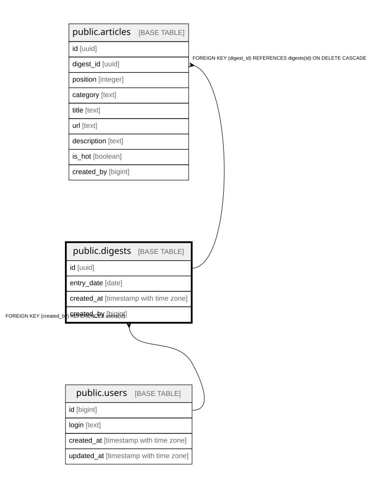

# public.digests

## Columns

| Name | Type | Default | Nullable | Children | Parents | Comment |
| ---- | ---- | ------- | -------- | -------- | ------- | ------- |
| id | uuid | gen_random_uuid() | false | [public.digest_articles](public.digest_articles.md) |  |  |
| entry_date | date |  | false |  |  |  |
| created_at | timestamp with time zone | now() | false |  |  |  |
| created_by | bigint |  | false |  | [public.users](public.users.md) |  |
| status | text |  | false |  |  |  |
| published_at | timestamp with time zone |  | true |  |  |  |

## Constraints

| Name | Type | Definition |
| ---- | ---- | ---------- |
| digests_created_at_not_null | n | NOT NULL created_at |
| digests_created_by_not_null | n | NOT NULL created_by |
| digests_draft_not_published | CHECK | CHECK (((status <> 'draft'::text) OR (published_at IS NULL))) |
| digests_entry_date_not_null | n | NOT NULL entry_date |
| digests_id_not_null | n | NOT NULL id |
| digests_status_check | CHECK | CHECK ((status = ANY (ARRAY['draft'::text, 'published'::text, 'private'::text]))) |
| digests_status_not_null | n | NOT NULL status |
| digests_pkey | PRIMARY KEY | PRIMARY KEY (id) |
| digests_created_by_fkey | FOREIGN KEY | FOREIGN KEY (created_by) REFERENCES users(id) |
| digests_created_by_entry_date_key | UNIQUE | UNIQUE (created_by, entry_date) |

## Indexes

| Name | Definition |
| ---- | ---------- |
| digests_pkey | CREATE UNIQUE INDEX digests_pkey ON public.digests USING btree (id) |
| digests_created_by_entry_date_key | CREATE UNIQUE INDEX digests_created_by_entry_date_key ON public.digests USING btree (created_by, entry_date) |

## Relations

---

> Generated by [tbls](https://github.com/k1LoW/tbls)
