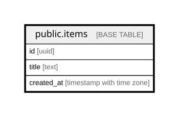

# public.items

## Columns

| Name | Type | Default | Nullable | Children | Parents | Comment |
| ---- | ---- | ------- | -------- | -------- | ------- | ------- |
| id | uuid | gen_random_uuid() | false |  |  |  |
| title | text |  | false |  |  |  |
| created_at | timestamp with time zone | now() | false |  |  |  |

## Constraints

| Name | Type | Definition |
| ---- | ---- | ---------- |
| items_created_at_not_null | n | NOT NULL created_at |
| items_id_not_null | n | NOT NULL id |
| items_title_check | CHECK | CHECK ((title <> ''::text)) |
| items_title_not_null | n | NOT NULL title |
| items_pkey | PRIMARY KEY | PRIMARY KEY (id) |

## Indexes

| Name | Definition |
| ---- | ---------- |
| items_pkey | CREATE UNIQUE INDEX items_pkey ON public.items USING btree (id) |

## Relations

---

> Generated by [tbls](https://github.com/k1LoW/tbls)
