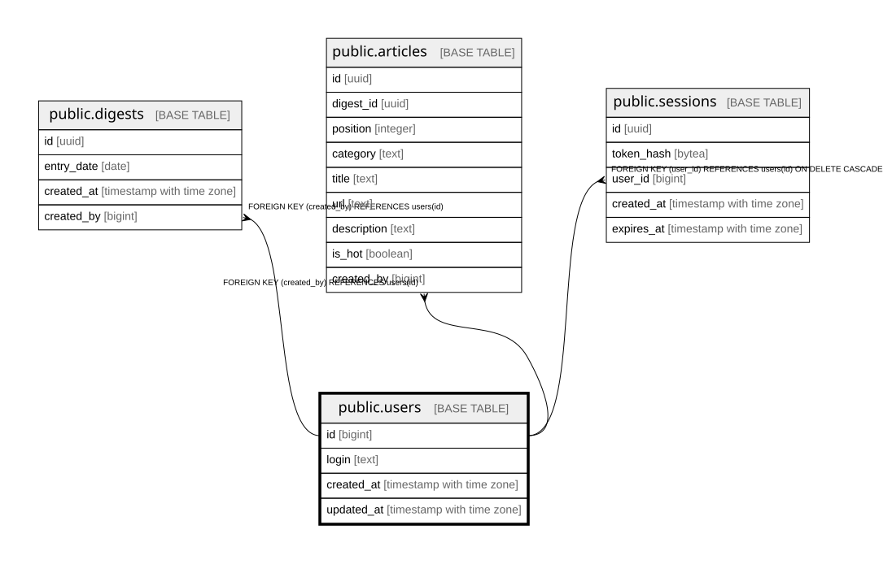

# public.users

## Columns

| Name | Type | Default | Nullable | Children | Parents | Comment |
| ---- | ---- | ------- | -------- | -------- | ------- | ------- |
| id | bigint |  | false | [public.digests](public.digests.md) [public.articles](public.articles.md) [public.sessions](public.sessions.md) |  |  |
| login | text |  | false |  |  |  |
| created_at | timestamp with time zone | now() | false |  |  |  |
| updated_at | timestamp with time zone | now() | false |  |  |  |

## Constraints

| Name | Type | Definition |
| ---- | ---- | ---------- |
| users_created_at_not_null | n | NOT NULL created_at |
| users_id_not_null | n | NOT NULL id |
| users_login_check | CHECK | CHECK ((login <> ''::text)) |
| users_login_not_null | n | NOT NULL login |
| users_updated_at_not_null | n | NOT NULL updated_at |
| users_pkey | PRIMARY KEY | PRIMARY KEY (id) |

## Indexes

| Name | Definition |
| ---- | ---------- |
| users_pkey | CREATE UNIQUE INDEX users_pkey ON public.users USING btree (id) |

## Relations

---

> Generated by [tbls](https://github.com/k1LoW/tbls)
